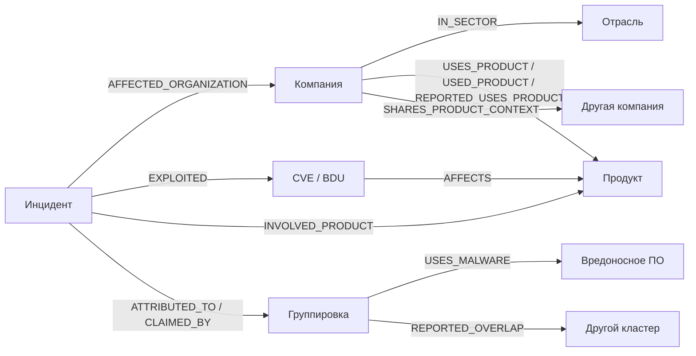

Справка к поставке 3.0.0. Основная методика — [weighted-graph-v3](graph_scoring.md), актуальные проверки — [validation.md](validation.md).

Общий вид включает только группировки и вредоносное ПО с прямой проверенной связью с инцидентом. Полные профили ATT&CK, весь арсенал группировок и расширение по техникам скрыты из CompanyGraph. Справочник сохранён отдельно.

Текущий общий вид: [CompanyGraph, компании и связанный ATT&CK](company_graph.md).

Справочник: [MITRE ATT&CK, инструменты и техники](attack_integration.md).

# Единый граф

Компании, отрасли, ПО, версии, CVE/BDU, инциденты, группировки и вредоносное ПО находятся в одной проекции Neo4j и используют общие ID. SQLite остаётся первичным хранилищем доказательств. Неизвестные связи не достраиваются ради связности картинки.

## Посмотреть результат

В обычном терминале Kali загрузите подготовленные данные:

```bash
python3 scripts/check_graph.py
```

После успешного импорта в Neo4j Browser выберите базу neo4j, вставьте запрос и переключитесь в Graph:

```cypher
MATCH path=(a)-[r]->(b)
WHERE a.is_demo = false AND b.is_demo = false
  AND none(n IN nodes(path) WHERE n:Publication OR n:Assertion OR n:Source OR n:Signal)
RETURN path LIMIT 300;

```

Запрос исключает служебные узлы, но сохраняет все виды предметных связей. Файл для копирования: unified_graph.cypher. Служебные узлы не удаляются: доказательства по-прежнему доступны отдельным запросом. Для оформления можно открыть :style и импортировать neo4j_style.grass — цвета отделят компании, инциденты, CVE и группировки.

Карточка Equifax с инцидентом и дальнейшими связями:

```cypher
MATCH p=(c:Company {id:'equifax'})<--(i:Incident)-[r]->(x)
WHERE i.is_demo=false
RETURN p;
```

Компании с одинаковым ПО:

```cypher
MATCH p=(a:Company)-[r]->(b:Company)
WHERE a.is_demo=false AND type(r)='SHARES_PRODUCT_CONTEXT'
RETURN p;
```

Источники связи, видимой в графе:

```cypher
MATCH (p:Publication)-[:SUPPORTS]->(a:Assertion)-[:SUBJECT]->(i:Incident)
WHERE i.catalog_id='equifax-2017' AND i.is_demo=false
RETURN p.title, p.url, a.kind, a.status, a.attributes_json, a.review_note;
```

## Схема и смысл связей



Установленная версия хранится в installed_version на связи использования продукта и в attributes_json доказательного Assertion: версия относится к конкретному сообщению о развёртывании, а не ко всем установкам продукта. В реальных новых кейсах точная версия неизвестна; учебный пример с версией сохраняется в отдельной demo-БД.

incident_affects, incident_exploited и incident_product описывают отдельный инцидент. У Incident есть incident_type, точность даты и, где известны, start_day/end_day. campaign — отдельный тип узла Incident; CVE кампании не переносится на все отдельные атаки или пользователей продукта. incident_part_of позволяет обоснованно связать отдельный инцидент с кампанией.

ATTRIBUTED_TO сохраняет оценку указанного источника и attribution_scope. CLAIMED_BY означает заявление об ответственности. Для неподтверждённых кандидатов используются REPORTED_* связи. REPORTED_OVERLAP — описанное исследователями пересечение активности; оно не объединяет узлы и не доказывает сотрудничество. COOPERATES_WITH поддерживается моделью, но не создана без отдельного основания.

SHARES_PRODUCT_CONTEXT строится только из подтверждённых утверждений об использовании одного продукта. На ребре сохраняются product_id, обе группы assertion_ids, ссылки и давность. Историческое использование не превращается в текущее, неизвестные версии не становятся одинаковыми. Пару компаний можно также увидеть через общий узел Product. Общий продукт, CVE или шифровальщик не доказывает деловые связи и сотрудничество атакующих.

Каждая исходная предметная связь имеет источник, выдержку, хеш, статус проверки и журнал изменений. Для новых видов обязательны basis и confidence. confirmed означает проверенное соответствие утверждения источнику; это не судебный вывод и не безусловное подтверждение атрибуции. confidence в библиотеке отражает уверенность проверки опубликованного утверждения и его ограничений. Основания: victim_report, research_report, vendor_advisory, government_advisory, legal_allegation, attacker_claim.

## Добавленные примеры

Импортированы 11 авторских пересказов и 31 утверждение. Новые сущности: 7 инцидентов/кампаний, 7 группировок/кластеров и 2 семейства вредоносного ПО. Рабочая база: 189 публикаций и 59 утверждений; 19 организаций и 11 продуктов в каталогах. В проекцию вошли 10 продуктов; неупомянутый продукт каталога не создаётся ради количества. Получилось 19 пар компаний с контекстом общего ПО. Четыре зарубежные организации добавлены как исторические кейсы с monitor_target=false и не включены в рейтинг текущих целей.

- Equifax: собственное сообщение связывает инцидент 2017 года с Apache Struts и CVE-2017-5638. Отдельное сообщение Минюста США хранится как обвинительная атрибуция, basis=legal_allegation.
- British Library: собственный разбор называет Rhysida; конкретная CVE не добавлена.
- Singtel и Qualys: собственные сообщения подтверждают инциденты на Accellion FTA; общий продукт связывает организации. Конкретная CVE или группировка их отдельным инцидентам не приписана.
- Кампания Accellion: отдельно сохранён технический бюллетень и историческая оценка Mandiant от 22.02.2021 об UNC2546, UNC2582 и пересечениях с FIN11. Это состояние оценки на дату источника, а не актуальный универсальный справочник идентичностей кластеров.
- Кампания MOVEit: русский материал Касперского связывает CL0P с CVE-2023-34362. Обзор кампании не доказывает атрибуцию каждого отдельного случая.
- TA505 и FIN11 соединяются через отдельный узел CLOP ransomware. Узел вредоносного ПО отделён от операции CL0P; одинаковое название не сливает их.
- Июльский инцидент Novabev 2025 связан с Novabev Group и ВинЛабом из существующего графа; неизвестные группировка, ПО и CVE не заполнены.

Все новые источники и точные пересказы: examples/threat_library.json. Это отдельная исследовательская библиотека, а не результат нового автоматического сетевого сбора. PDF Singtel и CISA пересказаны по индексированным фрагментам, что указано в метаданных.

## Источники

- https://investor.equifax.com/news-events/press-releases/detail/237/equifax-releases-details-on-cybersecurity-incident
- https://www.justice.gov/usao-ndga/pr/chinese-military-personnel-charged-computer-fraud-economic-espionage-and-wire-fraud
- https://www.oracle.com/security-alerts/alert-cve-2017-9805.html
- https://www.bl.uk/stories/blogs/posts/learning-lessons-from-the-cyber-attack
- https://www.singtel.com/content/dam/singtel/investorRelations/stockExchange/2021/NR-20210217-support%20affected%20stakeholders.pdf
- https://blog.qualys.com/vulnerabilities-threat-research/2021/04/02/qualys-update-on-accellion-fta-security-incident
- https://cloud.google.com/blog/topics/threat-intelligence/accellion-fta-exploited-for-data-theft-and-extortion
- https://content.govdelivery.com/accounts/USDHSCISA/bulletins/2c39d96
- https://www.kaspersky.ru/resource-center/definitions/cl0p-ransomware
- https://www.cisa.gov/sites/default/files/2023-06/aa23-158a-stopransomware-cl0p-ransomware-gang-exploits-moveit-vulnerability_2.pdf
- https://novabev.com/investors/news/official-statement-of-novabev-group-and-winelab-on-the-cyberattack/

## Пополнение и проверка

Для новой установки: init, knowledge-seed, knowledge-expand, threat-seed, затем reindex и graph-sync. Исследовательская библиотека добавляется командой threat-seed; повторный импорт сохраняет ручные подтверждения/опровержения и правки каталога.

entity-add FILE.json принимает массив сущностей ThreatActor/Incident/Malware с id, name и aliases. relation-add FILE.json принимает массив кандидатов с kind, subject, object, publication_id, excerpt и attributes; новые кандидаты имеют needs_review. Для новых видов attributes включает basis и confidence. Подтверждение — отдельный relation-review с именем аналитика и обоснованием.

При сборе и reindex автоматически отмечаются упоминания известных группировок, инцидентов и вредоносного ПО. Совместное упоминание компании, CVE и группировки не создаёт атрибуцию или инцидент. Такие связи вносятся после чтения источника. Изменение сохранённого текста снимает прежнее подтверждение; опровержение исключает предметное ребро и сохраняет доказательство с историей.

Актуальные результаты тестов и проверки Neo4j приведены в [протоколе поставки](validation.md).

HTML/JSON-отчёт: data/processed/real/report.html и report.json. Полный экспорт: data/processed/neo4j.json. Архив проекта без локальных данных создаётся командой `python3 scripts/build_submission.py`.
